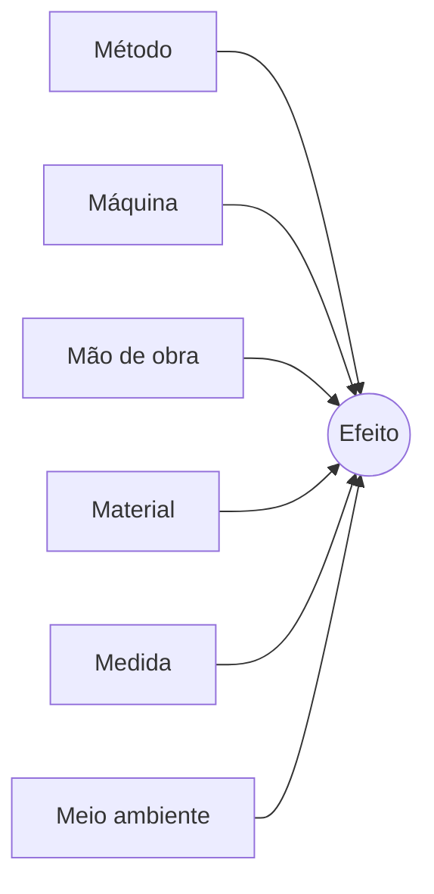

# Análise de causa — <efeito>

Data: <AAAA-MM-DD> · Participaram: <papéis>
Efeito: <indicador> = <valor> em <período> (meta <valor>) · Fonte: <…> · Recorte: <área, produto>

## Diagrama

## Causas levantadas

| # | Categoria | Causa | Status (verificada / provável / hipótese) | Evidência ou indício | Teste para confirmar | Custo do teste |
| --- | --- | --- | --- | --- | --- | --- |
| C1 |  |  | hipótese |  |  |  |

Escolhidas para aprofundar: C_, C_ — critério: <dados / teste mais barato>

## 5 porquês — C_

| Nível | Por quê? | Resposta | Evidência |
| --- | --- | --- | --- |
| 1 |  |  |  |
| 2 |  |  | (lacuna: falta dado X) |

Causa acionável: <…> · Sob controle de: <papel> · Removida, o efeito não volta porque: <…>

## Para o plano de ação

| Ordem | Ação | Tipo (verificar / corrigir) | Depende de |
| --- | --- | --- | --- |
| 1 |  | verificar | — |
| 2 |  | corrigir | 1 |
