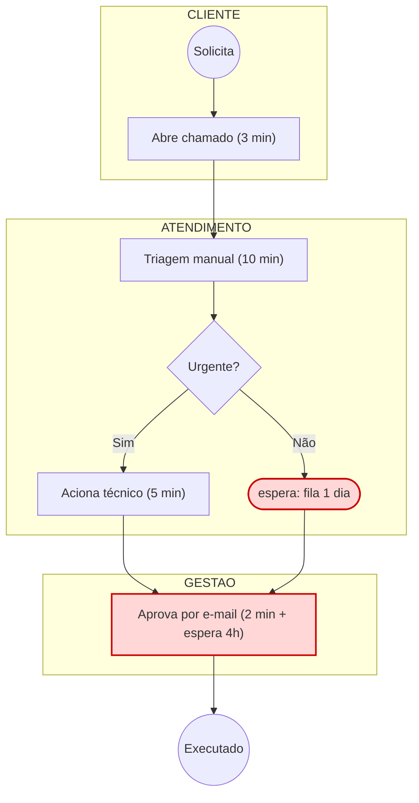

# Notação BPMN: Mermaid e `.bpmn`

Mermaid é o padrão de entrega desta skill: o `.mmd` abre em excalidraw.com, no VS Code e em qualquer visualizador, e sai em SVG vetorial + PNG em alta pelo `scripts/render_mermaid.mjs` (a cena editável fica com a skill vizinha terras-excalidraw). Use BPMN formal (BPMN 2.0 XML, `.bpmn`) apenas se o cliente exigir o arquivo para ferramenta de modelagem (Camunda Modeler, Bizagi, bpmn.io, Signavio): gere com `scripts/gerar_bpmn.py` e confira com `scripts/render_bpmn.mjs`.

## Correspondência de elementos

| BPMN | Mermaid (flowchart) | Uso |
| --- | --- | --- |
| Evento de início | `(("Início"))` | Gatilho do processo |
| Evento de fim | `((("Fim")))` | Entrega/encerramento |
| Tarefa | `["Verbo + objeto (tempo)"]` | Trabalho executado |
| Gateway exclusivo (XOR) | `{"Pergunta?"}` | Decisão sim/não, escolha de caminho |
| Gateway paralelo (AND) | `{{"Em paralelo"}}` | Duas ações simultâneas |
| Evento intermediário / espera | `(["espera: 1 dia"])` | Fila, aguardando terceiro |
| Sistema / tarefa de serviço | `[("Sistema: ERP")]` | Ação do sistema |
| Documento | `[/"Contrato.pdf"/]` | Entrada ou saída documental |
| Pool / Lane | `subgraph Ator` | Responsável |
| Fluxo de mensagem | `-.->|e-mail|` | Troca entre atores |
| Loop de retrabalho | `-.->|refaz|` | Devolve para passo anterior |
| Anotação de gargalo | `:::gargalo` | Destaca o ponto crítico |

## Do `processo.json` para o `.bpmn`

| `processo.json` | Elemento no `.bpmn` |
| --- | --- |
| `processo` / `layout.titulo` | `participant` (pool) e `process` |
| `ator` | `lane` do pool |
| ator em `bpmn.externos` | `participant` caixa-preta; os passos dele viram `messageFlow` |
| `gatilho` | `startEvent` (de mensagem quando o primeiro passo é de ator externo) |
| `fim` | `endEvent` |
| `tipo: tarefa` com `sistema` | `userTask`; sem sistema, `task` |
| `tipo: aprovacao` | `userTask` |
| `tipo: sistema` | `serviceTask` |
| `tipo: documento` | `task` |
| `tipo: espera` | `intermediateCatchEvent` com `timerEventDefinition` (`PT<min>M`) |
| `tipo: decisao` | `exclusiveGateway`; caminho principal é o `default` |
| `desvios` no passo | `sequenceFlow` com `conditionExpression` (em tarefa, o script põe o gateway depois) |
| `grupo_paralelo` repetido | `parallelGateway` abrindo e fechando o grupo |
| `layout.rotulos["Pn->Pm"]` | `name` da seta |
| `evidencia`, tempos, `excecoes` | `documentation` do elemento |

O bloco `bpmndi` (coordenadas de pool, lane, nó e seta) é obrigatório na prática: sem ele as ferramentas abrem o arquivo vazio. O schema XSD oficial da OMG aceita o arquivo sem diagrama, por isso a prova de que abre é o bpmn-js, não o XSD.

## Padrão de diagrama com raias

## Boas práticas

- Todo nó começa com **verbo no infinitivo** ou no presente ("Enviar", "Conferir"), com o tempo entre parênteses.
- Um gateway = uma pergunta clara, respondível com sim/não.
- Nomeie o ator no subgraph, não dentro do nó.
- Limite a 15–20 nós por diagrama; acima disso, agrupe em subprocesso (`[["Subprocesso: Aprovação"]]`).
- Marque com a classe `gargalo` todo nó com espera > 30% do lead time ou com retrabalho.
- O diagrama AS-IS deve retratar a realidade (inclusive o "jeitinho"), não o processo ideal. O ideal é o TO-BE.
